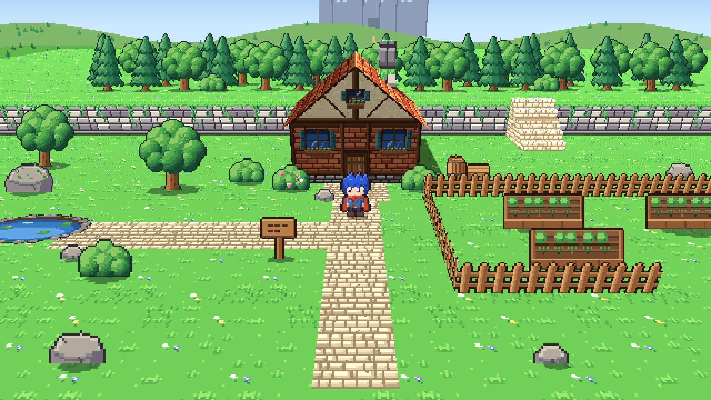
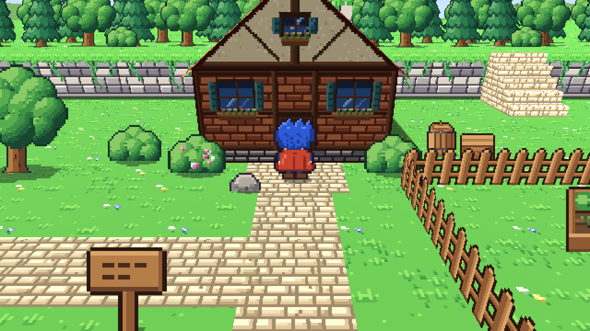
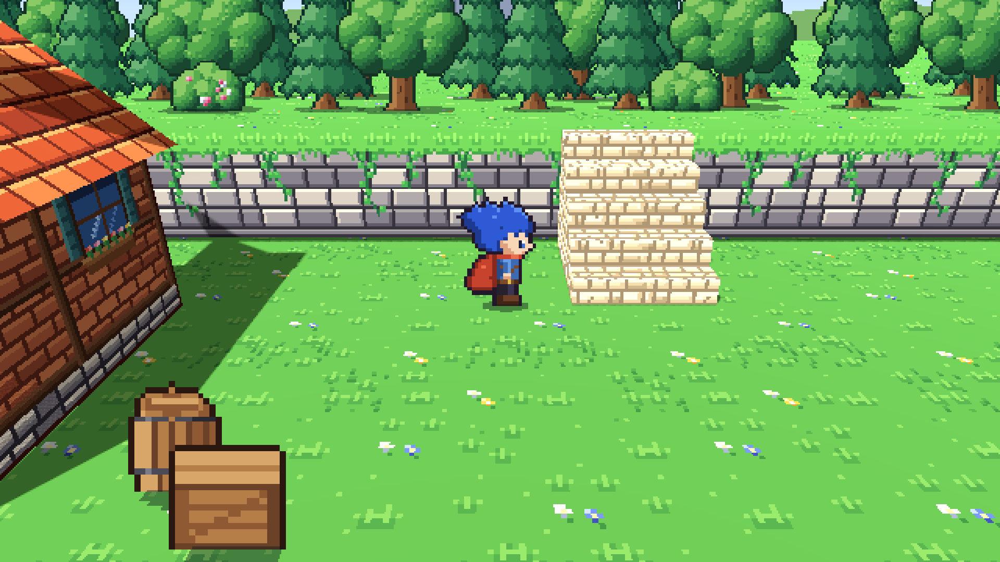
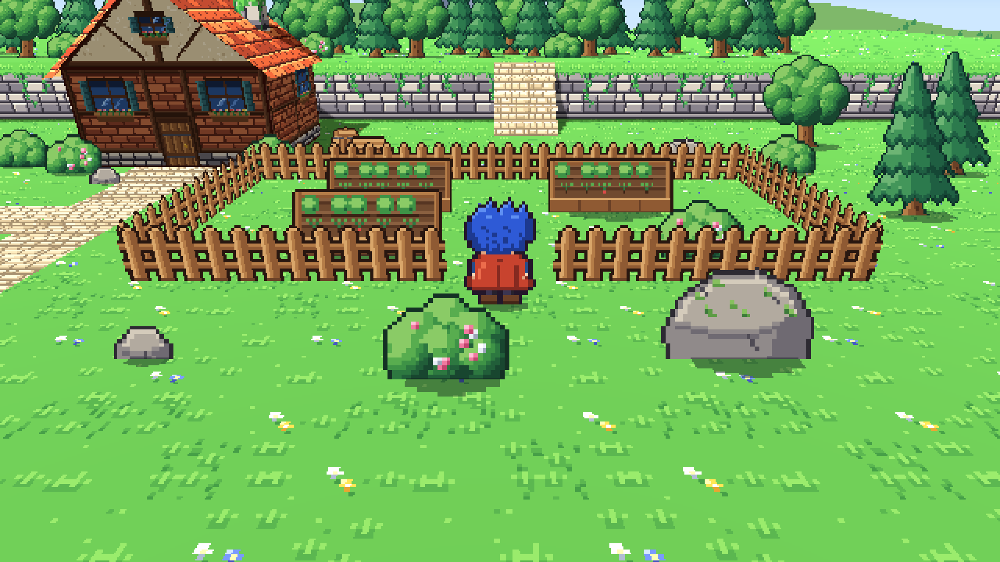
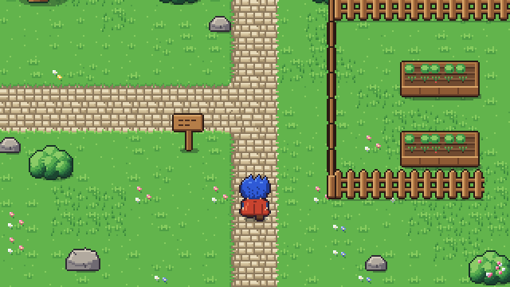

# Proyecto Brumaclara *(nombre provisional)*

Prototipo de un RPG de acción y aventura en pixel art, en solitario, hecho con **Godot 4.7**.
El diseño completo está en el GDD del proyecto (título de trabajo: *GUILD ZERO*).

Esta primera versión es una **demo de estilo artístico**: una casa con jardín (árboles, arbustos,
rocas, huerto, estanque, valla, terraza de piedra con escaleras y un castillo en el horizonte)
por la que se puede caminar con el protagonista. Estilo: escenario 3D con texturas pixel art y
personajes 2D, con cámara en perspectiva (como la imagen de referencia del proyecto).



| | |
|---|---|
|  |  |
|  |  |

## Cómo abrirlo

1. Instala [Godot 4.7](https://godotengine.org/download) (versión estándar, no hace falta .NET).
2. Abre Godot → *Importar* → selecciona `project.godot`.
3. Pulsa **F5**.

**Controles:** WASD o flechas para moverse.

## Decisiones técnicas de esta demo

| Tema | Decisión | Por qué |
|---|---|---|
| Perspectiva | Escenario 3D + personajes 2D (opción A del GDD), cámara en perspectiva inclinada | Es lo que da la profundidad de la referencia: paredes laterales, desniveles, horizonte |
| Pixel art | Texturas a 16 texeles por unidad, filtrado *nearest*; render a 640×360 escalado ×3 | Mantiene el aspecto pixelado aunque el mundo sea 3D |
| Personajes y vegetación | `Sprite3D` en modo *billboard* con sombra circular en el suelo | Siempre miran a la cámara, como en los RPG portátiles de referencia |
| Casas | `scripts/environment/house_mesh.gd`: genera paredes, hastiales y tejado a partir de tamaño y texturas | Se pueden crear más casas cambiando medidas y texturas en el inspector |
| Luz | Sol con sombras reales + luz ambiente | Las caras laterales se oscurecen solas y la casa proyecta sombra |
| Movimiento | Libre en 8 direcciones, sprites en 4 (derecha = izquierda reflejada) | Lo que pide el GDD para el prototipo |
| Renderizador | Compatibility (OpenGL) | Funciona en PCs modestos |

## Estructura

```
assets/                 Sprites y recursos (PNG, tileset, animaciones)
  characters/hero/        Protagonista: hoja de animación y SpriteFrames
  environment/            Muro, naturaleza, atrezo y textures/ (casa, tejado, suelo, piedra, cielo)
scenes/
  characters/player.tscn  Protagonista (CharacterBody3D + sprite billboard + cámara en el nivel)
  environment/            Una escena por objeto: sprite + sombra + colisión; cottage.tscn es la casa 3D
  levels/demo_cottage.tscn  Escena principal de la demo
scripts/                Lógica del protagonista y generador de casas
tools/
  art_generator/          Generador del pixel art (Python + Pillow)
  capture/                Herramienta que saca las capturas de docs/screenshots
docs/screenshots/       Capturas reales del juego
```

## Herramientas

**Regenerar el arte** (todo el pixel art está dibujado por código, con una paleta común):

```bash
pip install pillow
python3 tools/art_generator/generate.py
```

**Volver a sacar las capturas** (necesita pantalla; en un servidor, con `xvfb-run`):

```bash
godot --path . --script res://tools/capture/screenshot_tour.gd
```

## Estado

- [x] Demo de estilo 2D plana (descartada: demasiado plana)
- [x] Demo de estilo 3D + sprites, como la imagen de referencia
- [ ] Validar el estilo y la paleta
- [ ] Subir escaleras y desniveles caminando
- [ ] Combate básico (semana 2 de la hoja de ruta)
