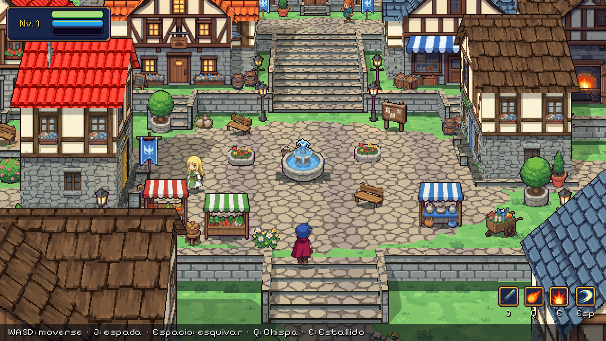

# Proyecto Brumaclara *(nombre provisional)*

RPG de acción y aventura de fantasía anime en píxel art, desarrollado en solitario con **Godot 4.7**.
Este repositorio es el **juego final** en desarrollo (ya no un prototipo ni una demo). El diseño completo
está en el GDD del proyecto (título de trabajo: *GUILD ZERO*) y en `docs/`: combate
(`diseno_combate.md`), árboles de habilidades de las seis afinidades (`arbol_habilidades.md`) y
bestiario (`bestiario.md`).

El juego empieza en **el pueblo de Brumaclara** (plaza de la Fuente, terraza de los gremios, calle del
Mercado, barrio de viviendas, establos y puerta sur; ver `docs/diseno_pueblo.md`) con sus primeros
habitantes. Por el camino del oeste se sale a **las afueras** (zona 1 del bestiario), con el lobo de la
Fractura y su guarida. Todo el contenido nuevo debe mantener este nivel visual (ver la
[guía de arte](docs/guia_de_arte.md)).



| | |
|---|---|
|  |  |
|  |  |
|  |  |


## Cómo jugar

1. Instala [Godot 4.7](https://godotengine.org/download) (versión estándar, no hace falta .NET).
2. Abre Godot → *Importar* → selecciona `project.godot`.
3. Pulsa **F5**. El juego empieza en el creador de personaje; tu elección se guarda para la próxima vez.

| Acción | Teclas |
|---|---|
| Moverse | WASD o flechas |
| Espada (encadena golpes) | J o clic izquierdo |
| Esquivar (invulnerable un instante) | Espacio o K |
| Chispa: proyectil de fuego (8 PM) | Q o U |
| Estallido: anillo de fuego alrededor del héroe (25 PM) | E o I |
| Hablar / abrir un cofre | F |

## Creador de personaje

Al empezar eliges hombre o mujer, peinado, color de pelo, color de piel y atuendo, con el héroe
caminando en la vista previa. Ver [docs/creador_personaje.md](docs/creador_personaje.md).

| | |
|---|---|
|  |  |

## Modo edición (desarrollo)

Pulsando **F1** mientras juegas, el juego se pausa y se abre un editor para decorar el nivel: una
paleta con todos los sprites (incluidas imágenes nuevas sin procesar, que se recortan y se escalan
solas), colocar, mover, girar (cambia a la vista dibujada para cada dirección), espejo, tamaño, borrar,
duplicar, deshacer y pincel de caminos. Los cambios se guardan solos en `data/edits/` y se juegan al
volver a pulsar F1. Ver [docs/modo_edicion.md](docs/modo_edicion.md).

| | |
|---|---|
|  |  |

## Sala de pruebas (desarrollo)

`scenes/dev/test_room.tscn` (ábrela en Godot y pulsa **F6**): bloques grises con la cámara real del
juego para medir la escala (cuadros de 1 unidad, una puerta de 1,2 × 2,2 y la altura del héroe) y probar
qué se puede subir: escaleras con escalones de 0,2, 0,3 y 0,45 y rampas de 30°, 45° y 55° (esta última
no se puede subir, a propósito).


## Qué hay ya en el juego

- **Protagonista** en cuatro direcciones: reposo, caminar, combo de espada, esquiva con estela, daño,
  hechizos y derrota.
- **Lobo de la Fractura**: vigila su guarida, persigue, avisa con un brillo violeta antes de saltar,
  muerde, cae y se disuelve; suelta un orbe de experiencia y reaparece al rato.
- **Combate**: golpes con retroceso, invulnerabilidad tras recibir daño, congelación breve en cada
  impacto, temblor de cámara, destellos y números de daño.
- **Progresión mínima**: experiencia, subida de nivel (más vida y maná), maná que se regenera y
  recargas visibles en la interfaz.
- **Escenario**: la terraza de la aldea con sus casas, pozo, huerto y faroles; la pradera con sus
  caminos; el bosque con su sombra; el claro de la Fractura con su suelo agrietado, la grieta luminosa,
  el menhir con runas y los cristales; montañas y nubes al fondo. Detrás de una roca hay un cofre que se
  abre y suelta experiencia.

## Cómo está hecho el arte

Los sprites, texturas, efectos e interfaz son imágenes generadas con IA a partir de prompts con un
estilo fijo (`art/ai/`, registradas en `art/FUENTES.md`) y revisadas a mano. El pipeline de
`tools/art_pipeline/` las convierte en recursos del juego: recorta el fondo, reduce cada bloque de
píxeles de la imagen a un píxel del juego, ajusta la paleta de cada familia de recursos, coloca los
fotogramas sobre su ancla y escribe las animaciones de Godot. El código solo carga, anima e integra
esos recursos.

## Estructura

```
art/            Imágenes de origen generadas con IA (Godot no las importa) y su registro
assets/         Recursos del juego producidos por el pipeline: personajes, escenario, efectos, interfaz
  nuevos/       Imágenes nuevas sin procesar para el modo edición
data/edits/     Cambios hechos con el modo edición, uno por nivel
data/skills/    Fichas de habilidades (Chispa, Estallido)
data/enemies/   Fichas de enemigos (lobo)
docs/           Guía de arte, diseño del pueblo y del combate, modo edición y capturas
scenes/
  levels/brumaclara.tscn  Escena principal: el pueblo
  levels/afueras.tscn     Las afueras de Brumaclara (zona 1, combate)
  characters/             Protagonista, lobo y habitantes
  effects/                Hechizos, impactos, polvo, orbe de experiencia y números de daño
  environment/            Árboles, plantas, objetos y fondo lejano
  ui/hud.tscn             Interfaz
  dev/test_room.tscn      Sala de pruebas greybox: escala, escaleras y pendientes (solo desarrollo)
scripts/
  components/   Vida, hitbox y hurtbox, reutilizables por cualquier personaje
  characters/   Protagonista y enemigos
  effects/      Comportamiento de los efectos
  environment/  Casas, cofre y fondo lejano
  systems/      Sensación de impacto, salidas, catálogo de sprites y cambios de cada nivel
  tools/        Modo edición (F1)
  ui/           Interfaz
shaders/        Bloques de terreno, franjas de suelo y contorno
tools/
  art_pipeline/   Convierte art/ai en recursos (Python)
  capture/        Capturas y grabación del combate
  tests/          Pruebas sin pantalla: combate, pueblo y modo edición
```

## Herramientas

```bash
pip install pillow numpy scipy
python3 tools/art_pipeline/build.py            # todos los recursos (o solo: hero wolf nature …)
godot --headless --path . --script res://tools/tests/test_combat.gd
godot --headless --path . --script res://tools/tests/test_town.gd
godot --headless --path . --script res://tools/tests/test_edit_mode.gd
godot --headless --path . --script res://tools/tests/test_hero_look.gd
godot --headless --path . --script res://tools/tests/test_climb.gd      # escaleras y rampas
godot --headless --path . --script res://tools/tests/test_data.gd       # fichas de habilidades y enemigos
xvfb-run godot --path . --script res://tools/capture/screenshot_tour.gd   # capturas (necesita pantalla)
```

## Estado

- [x] Las afueras de Brumaclara con el modelo artístico definitivo y combate funcional
- [ ] Validar el estilo y la sensación del combate
- [x] Pueblo de Brumaclara: barrios, edificios de los gremios y primeros habitantes
- [x] Modo edición para decorar los niveles dentro del juego
- [x] Creador de personaje (hombre y mujer, colores de pelo, piel y atuendo)
- [x] Protagonista sin capa (viajero que busca trabajo), hombre y mujer con hojas completas
- [x] Más peinados (12 modelos), 26 colores de pelo, 12 de piel, 19 atuendos, cuero y pantalón
- [x] Árbol de habilidades (182 nodos, 6 afinidades), santuario, 4 huecos + definitiva
- [x] 11 tipos de lobo (élites, jefe con invocaciones, elementales) en las afueras
- [ ] Más especies de enemigos con arte propio (los nuevos son variantes de color del lobo)
- [ ] Interiores, caja de diálogo y minimapa
- [x] Diseño de combate: afinidades, talentos, técnicas de gremio, estados y bestiario (`docs/diseno_combate.md`)
- [x] Habilidades y enemigos como fichas de datos
- [x] Diseño de las seis afinidades con sus árboles (218 nodos) y del bestiario (53 enemigos, 10 jefes)
- [ ] Árbol de habilidades en juego, equipo, diálogos y misiones

El prototipo anterior de la plaza del pueblo (arte dibujado por código) se conserva como referencia en la
rama `prototipo-plaza`.

## Licencias

- Código y arte: del autor del proyecto. El arte se generó con IA a petición del autor (ver
  `art/FUENTES.md`).
- Fuente *Pixelify Sans*: SIL Open Font License 1.1 (`assets/fonts/PIXELIFY_SANS_OFL.txt`).
