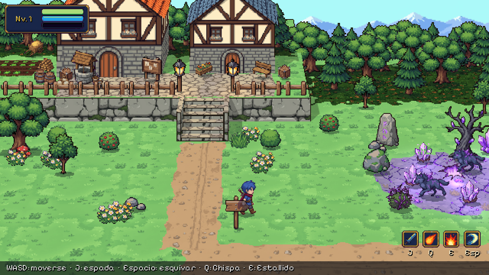
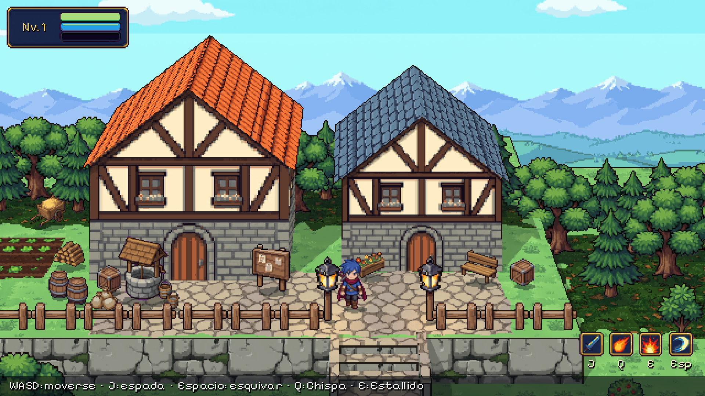
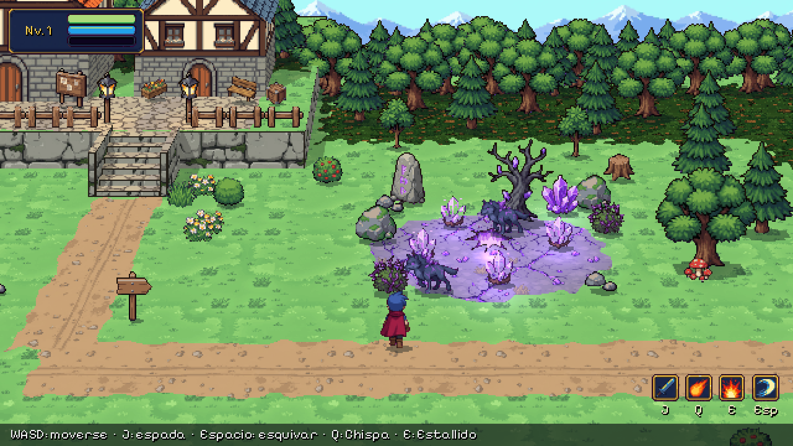

# Proyecto Brumaclara *(nombre provisional)*

RPG de acción y aventura de fantasía anime en píxel art, desarrollado en solitario con **Godot 4.7**.
El diseño completo está en el GDD del proyecto (título de trabajo: *GUILD ZERO*).

Esta versión es la **zona de demostración** que fija el modelo artístico definitivo del juego: las
afueras de Brumaclara, con el protagonista, un enemigo (el lobo de la Fractura) y el combate en tiempo
real completo. Todo el contenido nuevo debe mantener este nivel visual (ver la
[guía de arte](docs/guia_de_arte.md)).



| | |
|---|---|
|  |  |


## Cómo jugar

1. Instala [Godot 4.7](https://godotengine.org/download) (versión estándar, no hace falta .NET).
2. Abre Godot → *Importar* → selecciona `project.godot`.
3. Pulsa **F5**.

| Acción | Teclas |
|---|---|
| Moverse | WASD o flechas |
| Espada (encadena golpes) | J o clic izquierdo |
| Esquivar (invulnerable un instante) | Espacio o K |
| Chispa: proyectil de fuego (8 PM) | Q o U |
| Estallido: anillo de fuego alrededor del héroe (25 PM) | E o I |
| Abrir un cofre | F |

## Qué hay en la demo

- **Protagonista** en cuatro direcciones: reposo, caminar, combo de espada, esquiva con estela, daño,
  hechizos y derrota.
- **Lobo de la Fractura**: vigila su guarida, persigue, avisa con un brillo violeta antes de saltar,
  muerde, cae y se disuelve; suelta un orbe de experiencia y reaparece al rato.
- **Combate**: golpes con retroceso, invulnerabilidad tras recibir daño, congelación breve en cada
  impacto, temblor de cámara, destellos y números de daño.
- **Progresión mínima**: experiencia, subida de nivel (más vida y maná), maná que se regenera y
  recargas visibles en la interfaz.
- **Escenario**: la terraza de la aldea con sus casas, pozo, huerto y faroles; la pradera con sus
  caminos; el bosque con su sombra; el claro de la Fractura con su suelo agrietado, la grieta luminosa,
  el menhir con runas y los cristales; montañas y nubes al fondo. Detrás de una roca hay un cofre que se
  abre y suelta experiencia.

## Cómo está hecho el arte

Los sprites, texturas, efectos e interfaz son imágenes generadas con IA a partir de prompts con un
estilo fijo (`art/ai/`, registradas en `art/FUENTES.md`) y revisadas a mano. El pipeline de
`tools/art_pipeline/` las convierte en recursos del juego: recorta el fondo, reduce cada bloque de
píxeles de la imagen a un píxel del juego, ajusta la paleta de cada familia de recursos, coloca los
fotogramas sobre su ancla y escribe las animaciones de Godot. El código solo carga, anima e integra
esos recursos.

## Estructura

```
art/            Imágenes de origen generadas con IA (Godot no las importa) y su registro
assets/         Recursos del juego producidos por el pipeline: personajes, escenario, efectos, interfaz
docs/           Guía de arte y capturas
scenes/
  levels/demo_zone.tscn   Escena principal: las afueras de Brumaclara
  characters/             Protagonista y lobo
  effects/                Hechizos, impactos, polvo, orbe de experiencia y números de daño
  environment/            Árboles, plantas, objetos y fondo lejano
  ui/hud.tscn             Interfaz
scripts/
  components/   Vida, hitbox y hurtbox, reutilizables por cualquier personaje
  characters/   Protagonista y enemigos
  effects/      Comportamiento de los efectos
  environment/  Casas, cofre y fondo lejano
  systems/      Sensación de impacto
  ui/           Interfaz
shaders/        Bloques de terreno, franjas de suelo y contorno
tools/
  art_pipeline/   Convierte art/ai en recursos (Python)
  capture/        Capturas y grabación del combate
  tests/          Pruebas del combate sin pantalla
```

## Herramientas

```bash
pip install pillow numpy scipy
python3 tools/art_pipeline/build.py            # todos los recursos (o solo: hero wolf nature …)
godot --headless --path . --script res://tools/tests/test_combat.gd
xvfb-run godot --path . --script res://tools/capture/screenshot_tour.gd   # capturas (necesita pantalla)
```

## Estado

- [x] Zona de demostración con el modelo artístico definitivo y combate funcional
- [ ] Validar el estilo y la sensación del combate
- [ ] Reconstruir la plaza del pueblo con el nuevo pipeline
- [ ] Árbol de habilidades, equipo, diálogos y misiones

El prototipo anterior de la plaza del pueblo (arte dibujado por código) se conserva como referencia en la
rama `prototipo-plaza`.

## Licencias

- Código y arte: del autor del proyecto. El arte se generó con IA a petición del autor (ver
  `art/FUENTES.md`).
- Fuente *Pixelify Sans*: SIL Open Font License 1.1 (`assets/fonts/PIXELIFY_SANS_OFL.txt`).
