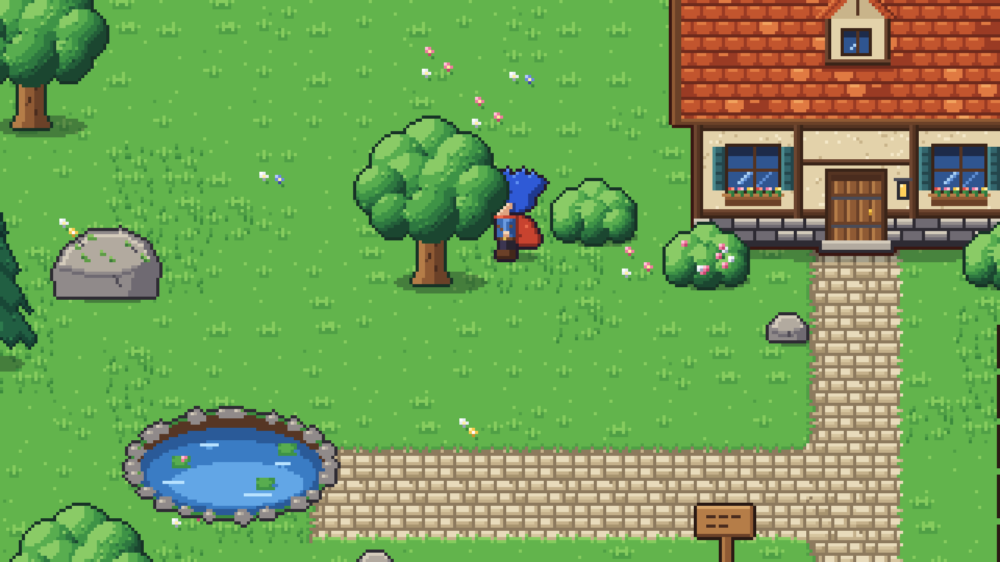

# Proyecto Brumaclara *(nombre provisional)*

Prototipo de un RPG de acción y aventura en pixel art, en solitario, hecho con **Godot 4.7**.
El diseño completo está en el GDD del proyecto (título de trabajo: *GUILD ZERO*).

Esta primera versión es una **demo de estilo artístico**: una casa con jardín (árboles, arbustos,
rocas, huerto, estanque, valla y muro de piedra) por la que se puede caminar con el protagonista.


| | |
|---|---|
|  |  |
|  |  |

## Cómo abrirlo

1. Instala [Godot 4.7](https://godotengine.org/download) (versión estándar, no hace falta .NET).
2. Abre Godot → *Importar* → selecciona `project.godot`.
3. Pulsa **F5**.

**Controles:** WASD o flechas para moverse.

## Decisiones técnicas de esta demo

| Tema | Decisión | Por qué |
|---|---|---|
| Perspectiva | Mundo 2D con vista elevada simulada (opción B del GDD) | Es lo que mejor reproduce el estilo de referencia con menos coste; sigue pendiente comparar con la opción 3D |
| Resolución | 640×360 escalado ×3 a 1920×1080, escala entera | Píxeles nítidos y del mismo tamaño en cualquier monitor 16:9 |
| Profundidad | Orden por Y (`y_sort_enabled`) con el origen de cada objeto en su base | El personaje pasa por delante o por detrás de árboles, casa y vallas |
| Movimiento | Libre en 8 direcciones, sprites en 4 (derecha = izquierda reflejada) | Lo que pide el GDD para el prototipo |
| Renderizador | Compatibility (OpenGL) | Suficiente para 2D y funciona en PCs modestos |

## Estructura

```
assets/                 Sprites y recursos (PNG, tileset, animaciones)
  characters/hero/        Protagonista: hoja de animación y SpriteFrames
  environment/            Suelo, muro, casa, naturaleza y atrezo
scenes/
  characters/player.tscn  Protagonista (CharacterBody2D)
  environment/            Una escena por objeto: sprite + colisión en la base
  levels/demo_cottage.tscn  Escena principal de la demo
scripts/characters/     Lógica del protagonista
tools/
  art_generator/          Generador del pixel art (Python + Pillow)
  capture/                Herramienta que saca las capturas de docs/screenshots
docs/screenshots/       Capturas reales del juego
```

## Herramientas

**Regenerar el arte** (todo el pixel art está dibujado por código, con una paleta común):

```bash
pip install pillow
python3 tools/art_generator/generate.py
```

**Volver a sacar las capturas** (necesita pantalla; en un servidor, con `xvfb-run`):

```bash
godot --path . --script res://tools/capture/screenshot_tour.gd
```

## Estado

- [x] Demo de estilo: casa, jardín y protagonista caminando
- [ ] Validar el estilo y la paleta
- [ ] Prototipo de cámara 3D + sprites 2D para comparar (decisión pendiente del GDD)
- [ ] Combate básico (semana 2 de la hoja de ruta)
