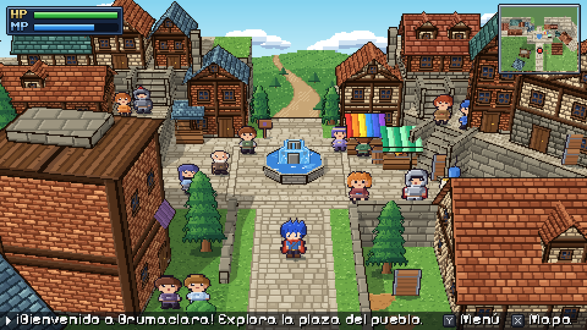
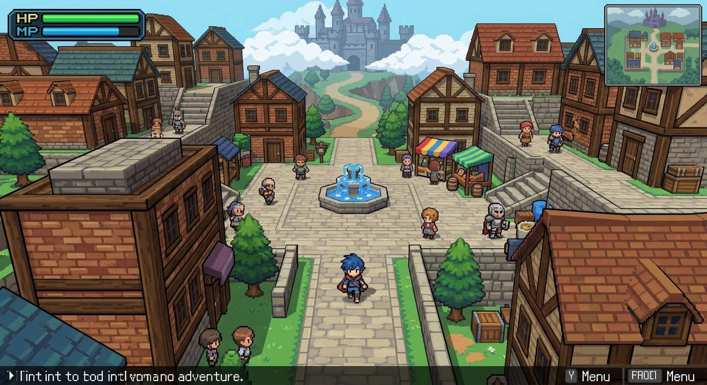
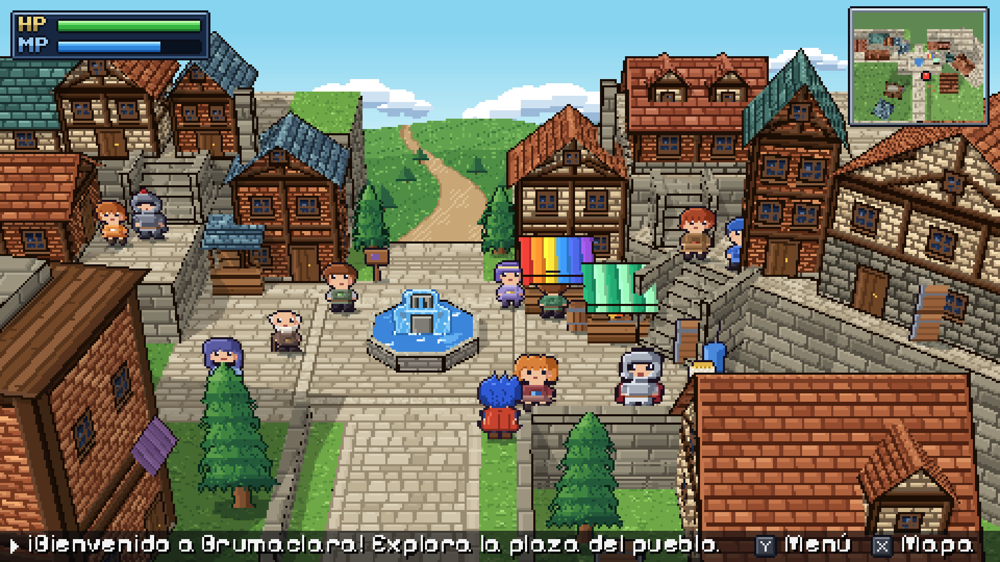
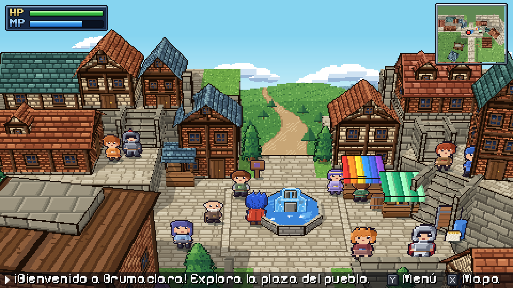
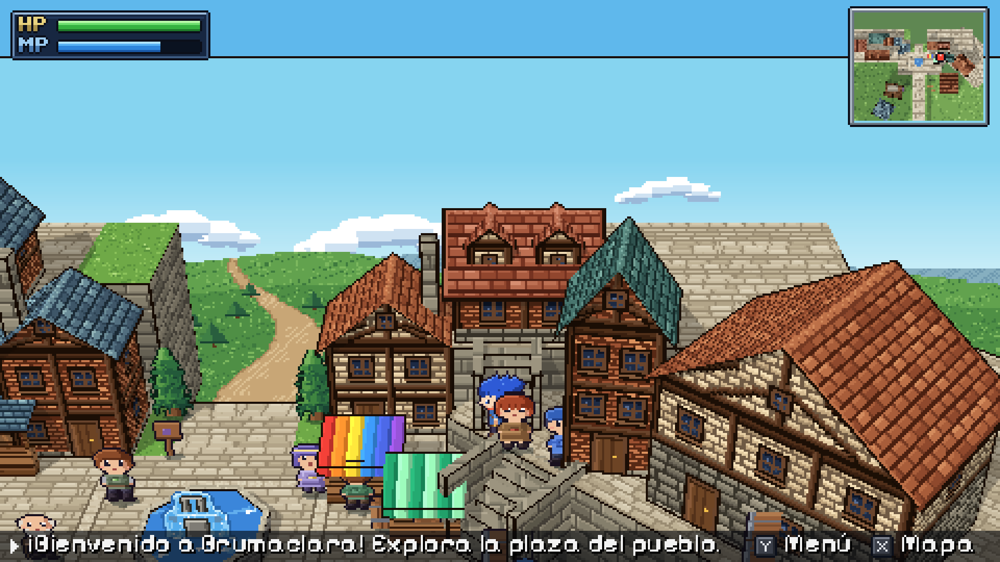
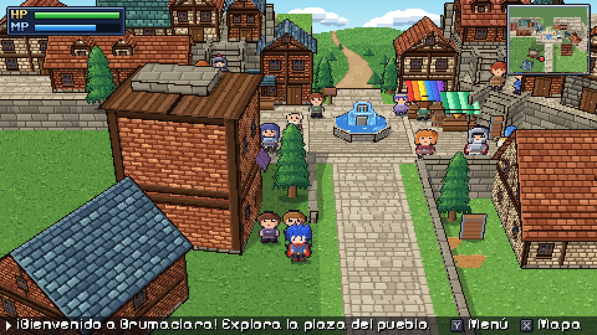

# Proyecto Brumaclara *(nombre provisional)*

Prototipo de un RPG de acción y aventura en pixel art, en solitario, hecho con **Godot 4.7**.
El diseño completo está en el GDD del proyecto (título de trabajo: *GUILD ZERO*).

> **Rama de referencia `prototipo-plaza`.** Guarda el prototipo de la plaza con arte dibujado por código
> y las herramientas con las que se ajustó a la imagen de referencia, para rehacerla con el arte nuevo.
> El juego actual está en la rama `main`.

Esta versión es una **demo de estilo artístico**: la plaza del pueblo de Brumaclara, reproducida a
partir de la imagen de referencia del proyecto (`docs/reference/concepto.jpg`). Se puede caminar
por la plaza, subir las escaleras a las pasarelas y ver a los aldeanos.



| Referencia | Juego |
|---|---|
|  |  |

| | |
|---|---|
|  |  |
|  |  |

## Cómo abrirlo

1. Instala [Godot 4.7](https://godotengine.org/download) (versión estándar, no hace falta .NET).
2. Abre Godot → *Importar* → selecciona `project.godot`.
3. Pulsa **F5**.

**Controles:** WASD o flechas para moverse.

## Cómo está hecho el estilo

| Tema | Decisión | Por qué |
|---|---|---|
| Perspectiva | Escenario 3D + personajes 2D (opción A del GDD) con cámara en perspectiva: 30° de inclinación y 26° de campo de visión | Son los valores medidos en la imagen de referencia (líneas de fuga y ancho del camino a dos profundidades) |
| Resolución | Render nativo a 480×270, escalado ×4 a 1920×1080 | Es el tamaño de "píxel" de la referencia: los sprites se ven a 1 texel = 1 píxel |
| Escenario | Bloques con el shader `terrain_block.gdshader`: textura de suelo arriba, de piedra en los lados y contorno oscuro en las aristas | Da los muros y terrazas con borde negro de la referencia con muy poca geometría |
| Casas | `scripts/environment/house_mesh.gd` monta paredes, hastiales y tejado a partir de su tamaño y de sus texturas | Cada casa de la referencia tiene su fachada propia (vigas, ventanas, puertas) generada en `tools/art_generator/village_houses.py` |
| Personajes y vegetación | Sprites que miran a la cámara (giran solo en vertical) con sombra circular | No se meten dentro de las paredes al acercarse a ellas |
| Luz | Sol frontal-izquierdo con sombras nítidas + luz ambiente, calibrados contra los colores de la referencia | Las caras laterales se oscurecen solas como en la imagen |
| Interfaz | HP/MP, minimapa en vivo (cámara cenital) y barra de mensajes, a 480×270 con fuente pixel *Pixelify Sans* (OFL) | Mismo diseño que la referencia |

## Estructura

```
assets/        Texturas y sprites (generados), fuente y animación del protagonista
  characters/    Protagonista y aldeanos
  environment/   Casas (una carpeta por casa), texturas de suelo/muro/agua, vegetación y objetos
  ui/            Piezas de la interfaz
materials/     Materiales de bloques, madera, agua, toldos y fondo
scenes/
  levels/village.tscn   Escena principal: el pueblo
  characters/           Protagonista (con su cámara) y aldeano genérico
  environment/          Fuente, puestos, quiosco, vegetación y objetos
  ui/hud.tscn           Interfaz
scripts/       Protagonista, aldeanos, generador de casas e interfaz
shaders/       Bloques de terreno y agua animada
tools/
  art_generator/  Generador del pixel art (Python + Pillow)
  capture/        Herramienta que saca las capturas de docs/screenshots
docs/          Imagen de referencia y capturas reales del juego
```

## Herramientas

**Regenerar el arte** (todo el pixel art está dibujado por código):

```bash
pip install pillow
python3 tools/art_generator/generate.py
```

**Reconstruir la plaza** a partir de su layout (`tools/plaza_layout/LEEME.md`):

```bash
python3 tools/plaza_layout/layout.py tools/plaza_layout/layout.json
godot --headless --path . --script res://tools/plaza_builder/build_plaza.gd -- prefabs level
```

**Volver a sacar las capturas** (necesita pantalla; en un servidor, con `xvfb-run`):

```bash
godot --path . --script res://tools/capture/screenshot_tour.gd
```

## Estado

- [x] Demo de estilo: plaza del pueblo como la imagen de referencia
- [ ] Validar el estilo
- [ ] Interiores, diálogos con los aldeanos y menú
- [ ] Combate básico (semana 2 de la hoja de ruta)

## Licencias

- Código y arte: del autor del proyecto.
- Fuente *Pixelify Sans*: SIL Open Font License 1.1 (`assets/fonts/PIXELIFY_SANS_OFL.txt`).
