# Proyecto Brumaclara *(nombre provisional)*

RPG de acción y aventura de fantasía anime en píxel art, desarrollado en solitario con **Godot 4.7**.
Este repositorio es el **juego final** en desarrollo (ya no un prototipo ni una demo). El diseño completo
está en el GDD del proyecto (título de trabajo: *GUILD ZERO*) y en `docs/`: combate
(`diseno_combate.md`), árboles de habilidades de las seis afinidades (`arbol_habilidades.md`) y
bestiario (`bestiario.md`).

El juego empieza en **el pueblo de Brumaclara** (plaza de la Fuente, terraza de los gremios, calle del
Mercado, barrio de viviendas, establos y la gran puerta sur; ver `docs/diseno_pueblo.md`) y se puede
jugar entero su **capítulo 1, «El precio de una noche»**: el primer contrato de Mara, la caja de
suministros, la grieta de las afueras con la Madre de la manada, Iven, Caldus y el rango cero oficial.
Por la puerta sur (o el camino del oeste) se sale a **las afueras** (zona 1 del bestiario), y desde la
terraza de los gremios se llega al **Patio de pruebas**, donde se puede llamar a cualquier criatura del
bestiario para practicar el combate. Hay día y noche: al anochecer se encienden faroles y farolas.
Todo el contenido nuevo debe mantener este nivel visual (ver la [guía de arte](docs/guia_de_arte.md) y
[cómo seguir sin generar tantos sprites](docs/guia_arte_sin_tantos_sprites.md)).

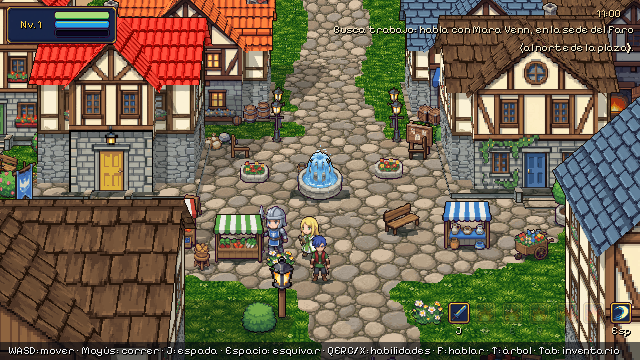

| | |
|---|---|
| 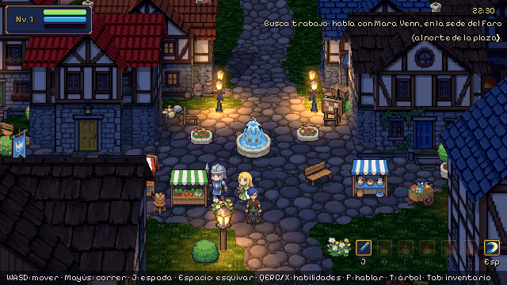 | 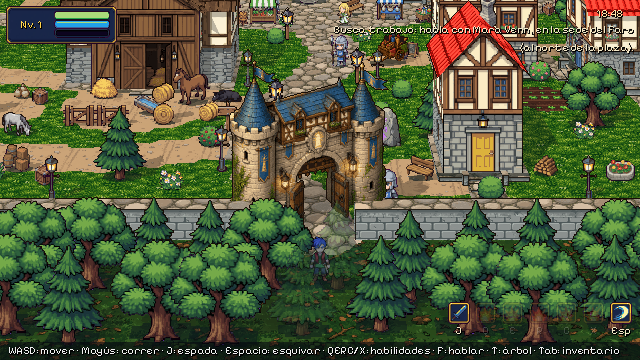 |
| 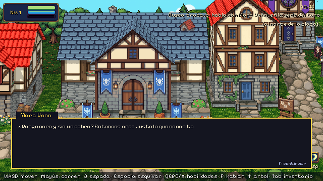 | 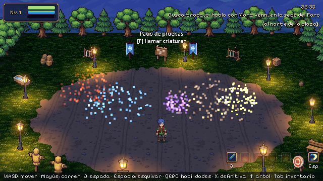 |
| 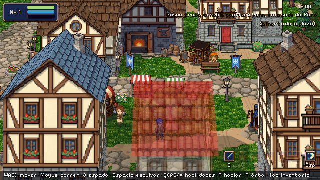 | 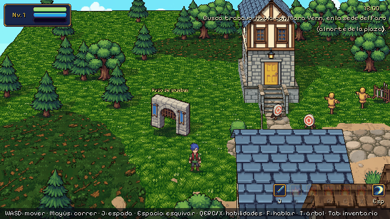 |

| | |
|---|---|
| 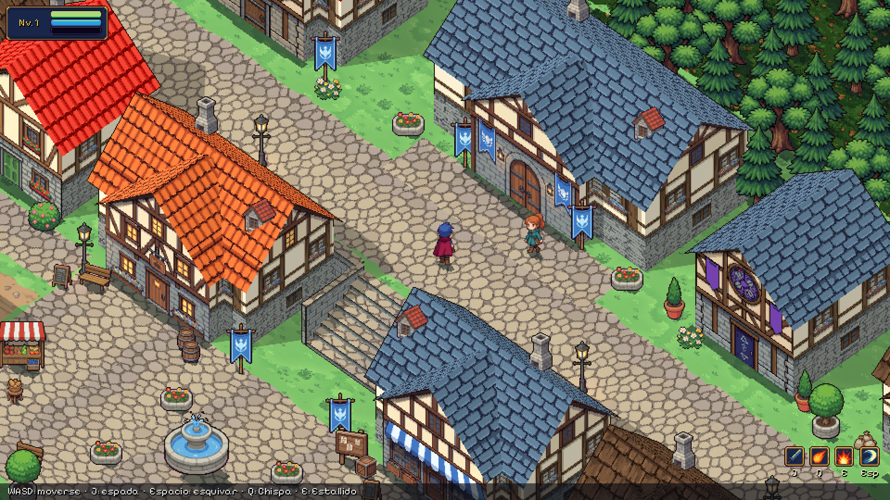 | 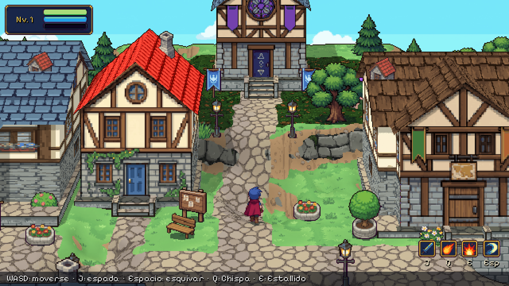 |
| 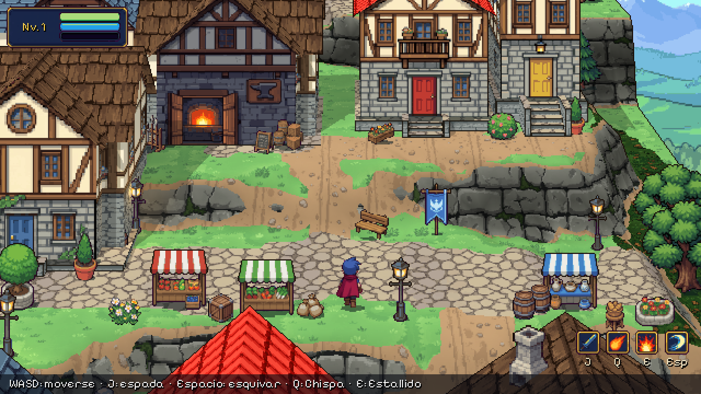 | 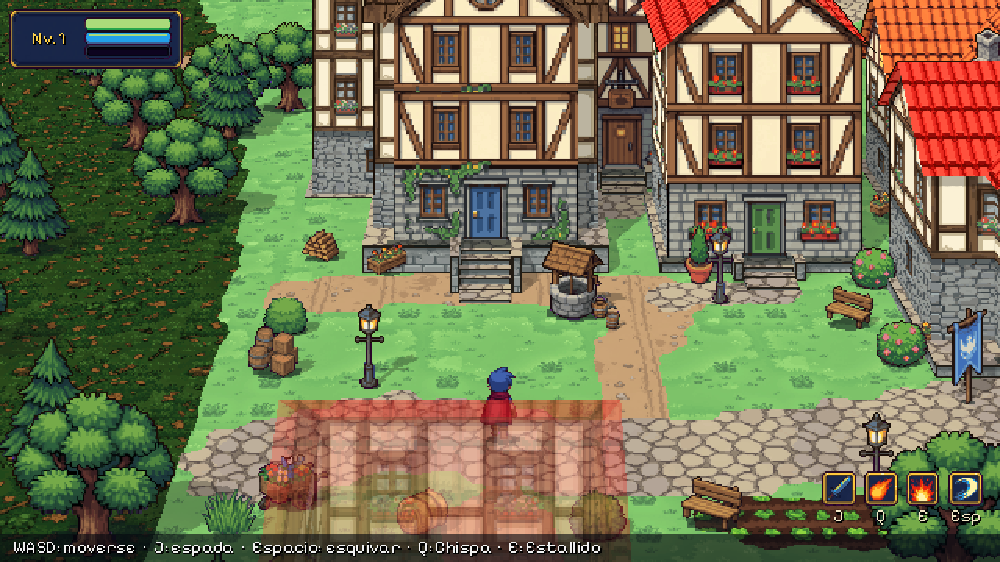 |
| 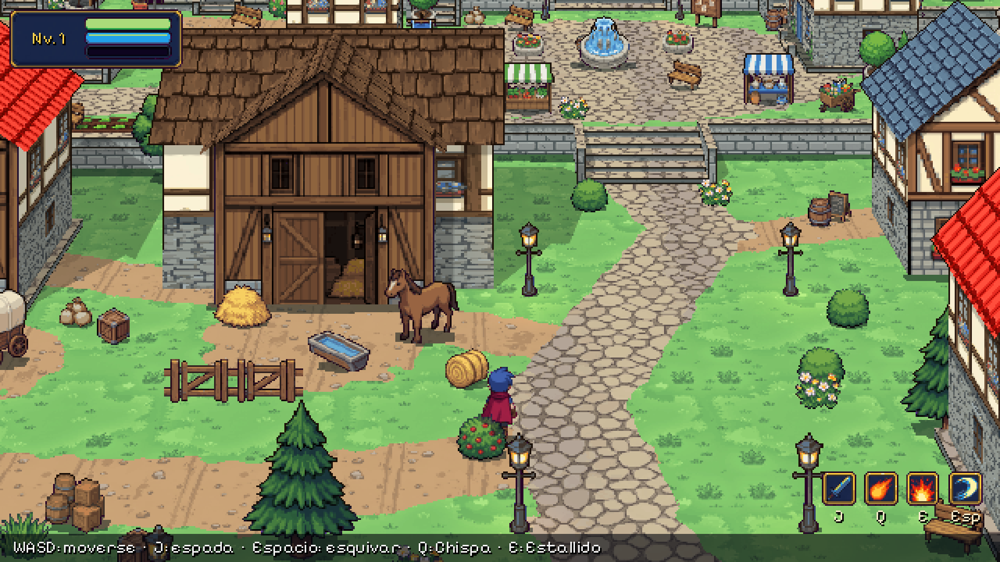 | 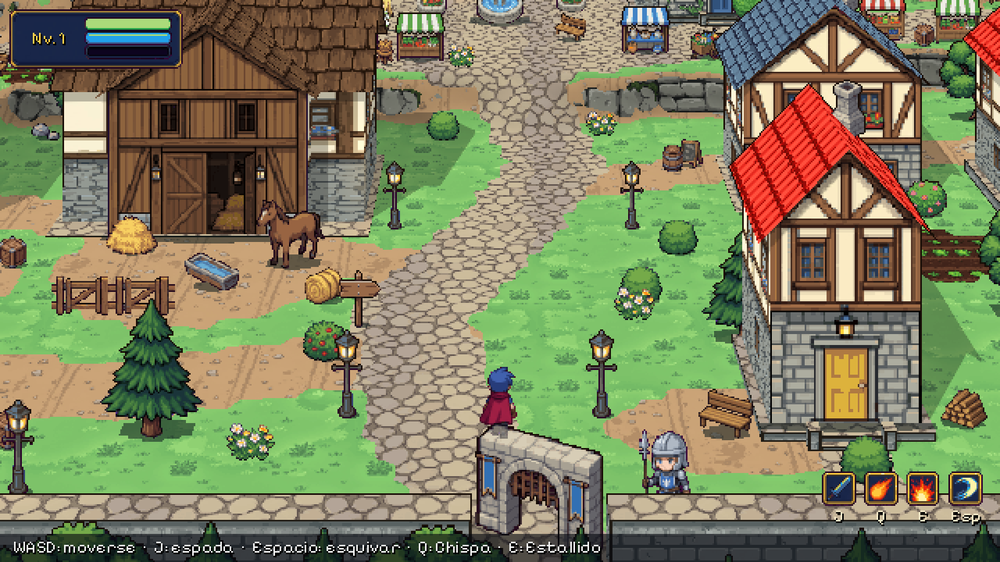 |

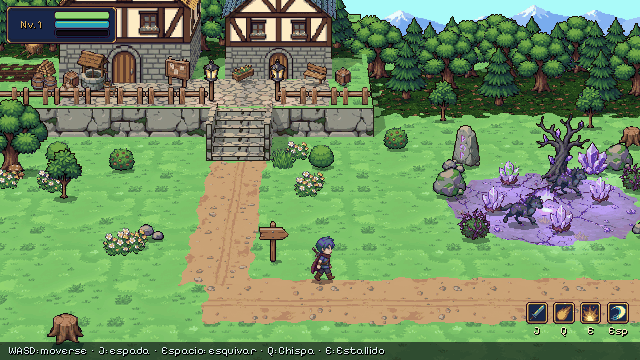

## Cómo jugar

1. Descarga [Godot 4.7](https://godotengine.org/download) (versión estándar, no hace falta .NET). No se
   instala: es un `.zip` con un ejecutable que se abre tal cual.
2. Descarga el proyecto (*Code → Download ZIP*) y descomprímelo.
3. Abre Godot → *Importar* → selecciona `project.godot` → **F5**. El juego empieza en el creador de
   personaje; tu elección se guarda para la próxima vez.

**En el navegador:** `sh tools/web/publish.sh` exporta el juego para la web y lo sube a la rama
`gh-pages`; con GitHub Pages activado sobre esa rama (*Settings → Pages*) se juega en
`https://a-quiles.github.io/Brumaclara/`, sin instalar nada.

| Acción | Teclas |
|---|---|
| Moverse (en 8 direcciones) | WASD o flechas |
| Correr | Mayús (mantener) |
| Espada (encadena golpes; también andando, nunca corriendo) | J o clic izquierdo |
| Esquivar (invulnerable un instante) | Espacio o K |
| Habilidades equipadas | Q, E, R, C |
| Definitiva | X |
| Árbol de habilidades | T |
| Inventario (usar pociones y tónicos) | Tab |
| Hablar (avanza el diálogo; flechas para elegir) / abrir un cofre / tablón del patio | F |
| Saltar al siguiente atardecer o amanecer | N |
| Modo edición (desarrollo) | M |

Para entrar por una puerta hay que andar hacia ella (pasar por delante no te mete dentro); el héroe
entra andando y la pantalla funde a negro. Un edificio o un objeto (árbol, carro, caballo...) solo se
vuelve transparente cuando tapa al héroe entero, y entonces su silueta se ve encima; si lo tapa a medias,
sigue opaco. En la versión del navegador, lo que cambies con el modo edición (M) se guarda en ese navegador.

## Creador de personaje

Al empezar eliges hombre o mujer, peinado, color de pelo, color de piel y atuendo. El héroe se
queda quieto en la vista previa; arrástralo con el ratón para girarlo. Ver [docs/creador_personaje.md](docs/creador_personaje.md).

| | |
|---|---|
| 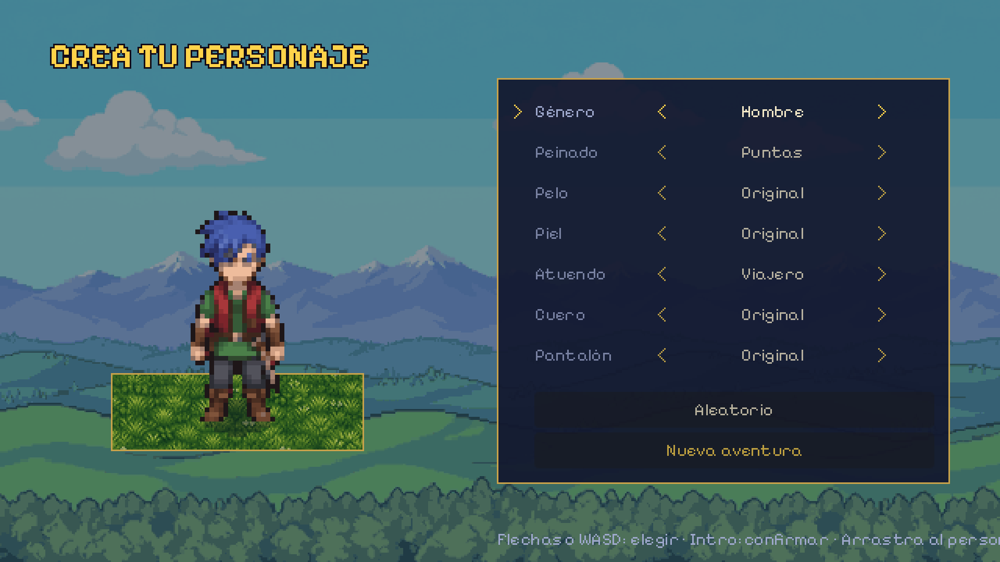 | 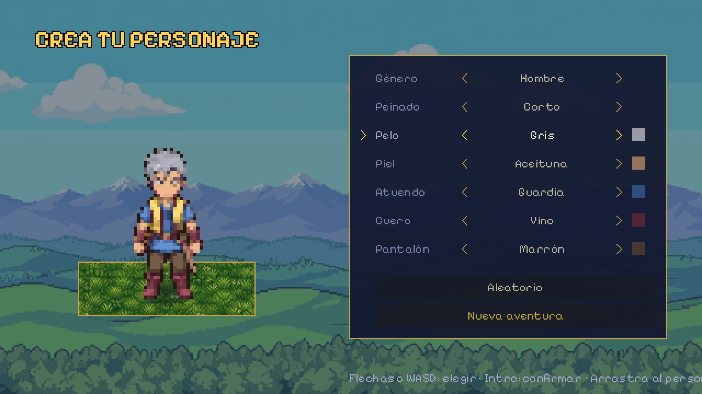 |

## Modo edición (desarrollo)

Pulsando **M** mientras juegas, el juego se pausa y se abre un editor para decorar el nivel: una
paleta con todos los sprites (incluidas imágenes nuevas sin procesar, que se recortan y se escalan
solas), colocar, mover, girar (cambia a la vista dibujada para cada dirección), espejo, tamaño, borrar,
duplicar, deshacer y pincel de caminos. Los cambios se guardan solos en `data/edits/` y se juegan al
volver a pulsar M. Ver [docs/modo_edicion.md](docs/modo_edicion.md).

| | |
|---|---|
|  | 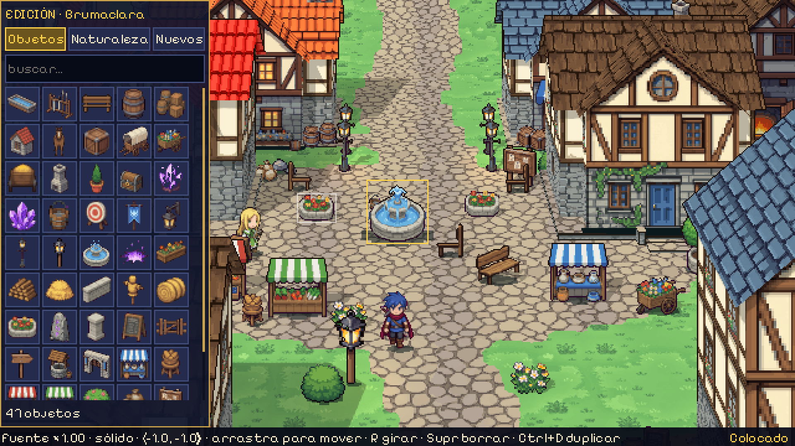 |

## Sala de pruebas (desarrollo)

`scenes/dev/test_room.tscn` (ábrela en Godot y pulsa **F6**): bloques grises con la cámara real del
juego para medir la escala (cuadros de 1 unidad, una puerta de 1,2 × 2,2 y la altura del héroe) y probar
qué se puede subir: escaleras con escalones de 0,2, 0,3 y 0,45 y rampas de 30°, 45° y 55° (esta última
no se puede subir, a propósito).

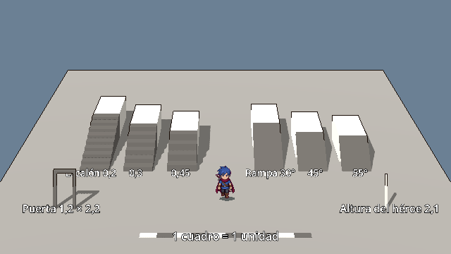

## Qué hay ya en el juego

- **Capítulo 1 jugable de principio a fin** con objetivos en pantalla (arriba a la derecha), caja de
  diálogo con elecciones que se guardan (la caja: cerrada, abierta, repartida o revisada por Elia; el
  tono con Iven; a quién dar los restos de la grieta) y recompensas. Ver `scripts/systems/quests.gd`.
- **Día y noche** (un día dura 8 minutos; N salta al siguiente atardecer o amanecer): la luz se vuelve
  azul y las farolas, faroles y la gran puerta proyectan charcos de luz cálida.
- **Patio de pruebas**: el tablón (F) llama a cualquier enemigo del bestiario por zonas, en grupo, en
  oleada o al jefe; «Limpiar» los retira.
- **Comerciantes**: Lio y Sella venden pociones, tónicos y cristales con las monedas que sueltan los
  monstruos; seis comercios ambulantes nuevos en la calle del Mercado.
- **Vecinos que pasean**: dos guardias patrullan y Elia va y viene entre la plaza y el mercado.
- **Protagonista** en cuatro direcciones (reposo, caminar, combo de espada, esquiva con estela, daño,
  hechizos y derrota) y **creador de personaje** con 6 peinados dibujados y decenas de colores.
- **El pueblo de Brumaclara** con sus barrios, gremios y habitantes, y **cuatro interiores** a los que
  se entra por la puerta: la Posada del Cruce, la Sede del Faro, la Tienda de Nara y el Taller de Elia,
  amueblados (32 muebles) y con luz propia.
- **Personajes de la historia**: Mara, Elia, el carretero y la guardia, más **Iven** (el rival, en la
  Sede del Faro) y **Neris** (la investigadora del Archivo), con sus frases.
- **Las afueras** (zona 1) con el claro de la Fractura y un bestiario creciente: 11 lobos (élites, la
  Madre de la manada y lobos elementales), hongos, murciélagos, esqueletos, gólems, espectros y sus
  versiones **fracturadas**, y del Bosque de los Susurros el **sporíneo** (abanico de esporas), el
  **guardián de raíces** (golpe en área), la **polilla lumínica** y el **espectro de la Fractura**.
  Cada enemigo avisa antes de atacar: salto, golpe en área o disparos.
- **Poderes vistosos**: cada habilidad suma partículas en los colores de su afinidad (el fuego sube,
  el hielo cae, el rayo restalla, la sombra gira, la tierra salta en cascotes, la luz asciende), un
  anillo de choque, un destello de luz, estelas en los proyectiles y auras en el héroe.
- **Combate**: golpes con retroceso, invulnerabilidad tras recibir daño, congelación breve en cada
  impacto, temblor de cámara, destellos, números de daño y estados (quemadura, frío, marcas...).
- **Árbol de habilidades** (T, o en el santuario): seis afinidades con **21 habilidades activas
  distintas cada una, todas con su mejora**, pasivas y una definitiva, más el tronco del aventurero;
  cada habilidad con su propio icono. Cuatro ranuras (Q, E, R, C) y la definitiva (X). Lista completa
  en `docs/habilidades_lista.md`.
- **Progresión**: experiencia, niveles, PA y puntos de atributo, guardado de la partida.

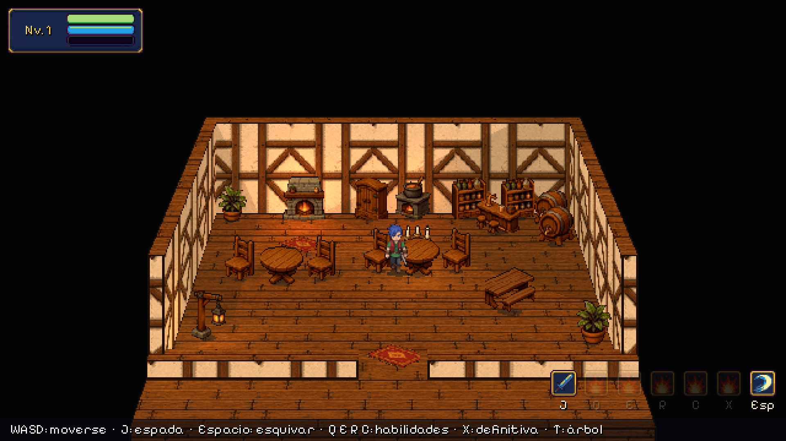

| | |
|---|---|
| 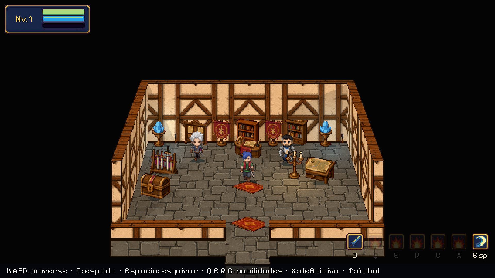 | 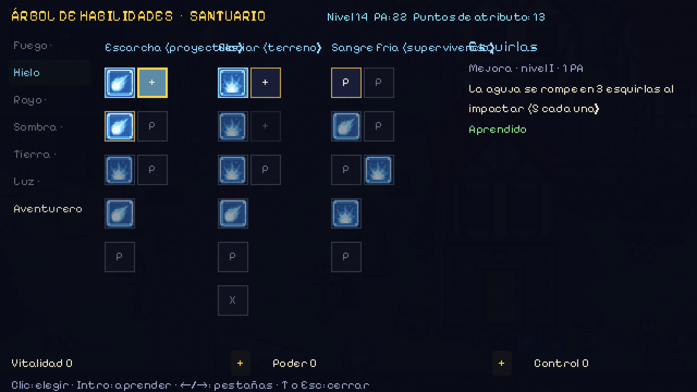 |

## Cómo está hecho el arte

Los sprites, texturas, efectos e interfaz son imágenes generadas con IA a partir de prompts con un
estilo fijo (`art/ai/`, registradas en `art/FUENTES.md`) y revisadas a mano. El pipeline de
`tools/art_pipeline/` las convierte en recursos del juego: recorta el fondo, reduce cada bloque de
píxeles de la imagen a un píxel del juego, ajusta la paleta de cada familia de recursos, coloca los
fotogramas sobre su ancla y escribe las animaciones de Godot. El código solo carga, anima e integra
esos recursos.

## Estructura

```
art/            Imágenes de origen generadas con IA (Godot no las importa) y su registro
assets/         Recursos del juego producidos por el pipeline: personajes, escenario, efectos, interfaz
  nuevos/       Imágenes nuevas sin procesar para el modo edición
data/edits/     Cambios hechos con el modo edición, uno por nivel
data/skills/    Fichas de habilidades (Chispa, Estallido)
data/enemies/   Fichas de enemigos (lobo)
docs/           Guía de arte, diseño del pueblo y del combate, modo edición y capturas
scenes/
  levels/brumaclara.tscn  Escena principal: el pueblo
  levels/afueras.tscn     Las afueras de Brumaclara (zona 1, combate)
  characters/             Protagonista, lobo y habitantes
  effects/                Hechizos, impactos, polvo, orbe de experiencia y números de daño
  environment/            Árboles, plantas, objetos y fondo lejano
  ui/hud.tscn             Interfaz
  dev/test_room.tscn      Sala de pruebas greybox: escala, escaleras y pendientes (solo desarrollo)
scripts/
  components/   Vida, hitbox y hurtbox, reutilizables por cualquier personaje
  characters/   Protagonista y enemigos
  effects/      Comportamiento de los efectos
  environment/  Casas, cofre y fondo lejano
  systems/      Sensación de impacto, salidas, catálogo de sprites y cambios de cada nivel
  tools/        Modo edición (M)
  ui/           Interfaz
shaders/        Bloques de terreno, franjas de suelo y contorno
tools/
  art_pipeline/   Convierte art/ai en recursos (Python)
  capture/        Capturas y grabación del combate
  tests/          Pruebas sin pantalla: combate, pueblo y modo edición
```

## Herramientas

```bash
pip install pillow numpy scipy
python3 tools/art_pipeline/build.py            # todos los recursos (o solo: hero wolf nature …)
godot --headless --path . --script res://tools/tests/test_combat.gd
godot --headless --path . --script res://tools/tests/test_town.gd
godot --headless --path . --script res://tools/tests/test_edit_mode.gd
godot --headless --path . --script res://tools/tests/test_hero_look.gd
godot --headless --path . --script res://tools/tests/test_climb.gd      # escaleras y rampas
godot --headless --path . --script res://tools/tests/test_data.gd       # fichas de habilidades y enemigos
godot --headless --path . --script res://tools/tests/test_story.gd      # capítulo 1 entero, tienda y patio de pruebas
python3 tools/levels/people.py && python3 tools/levels/town_v2.py      # habitantes, comercios, salidas del pueblo
xvfb-run godot --path . --script res://tools/capture/screenshot_tour.gd   # capturas (necesita pantalla)
```

## Estado

- [x] Las afueras de Brumaclara con el modelo artístico definitivo y combate funcional
- [ ] Validar el estilo y la sensación del combate
- [x] Pueblo de Brumaclara: barrios, edificios de los gremios y primeros habitantes
- [x] Modo edición para decorar los niveles dentro del juego
- [x] Creador de personaje (hombre y mujer, colores de pelo, piel y atuendo)
- [x] Protagonista sin capa (viajero que busca trabajo), hombre y mujer con hojas completas
- [x] Peinados redibujados (corto y coleta, sobre las hojas originales) y 26 colores de pelo, 12 de piel, 19 atuendos, cuero y pantalón
- [ ] Más peinados dibujados: melena y rapado (hombre); bob, suelta, moño y trenzas (mujer) — cola en `tools/data/hair_queue.json`
- [x] Árbol de habilidades (182 nodos, 6 afinidades), santuario, 4 huecos + definitiva
- [x] 11 tipos de lobo (élites, jefe con invocaciones, elementales) en las afueras
- [x] 5 monstruos con arte propio: hongo errante, murciélago de cueva, esqueleto guerrero, gólem de musgo y espectro errante (`tools/art_pipeline/build.py monsters`)
- [x] 4 versiones fracturadas (violeta, anómalas) en el claro de la Fractura: hongo, murciélago, esqueleto y gólem
- [ ] Espectro fracturado y los monstruos de la zona 2 (Guardián de raíces, Polilla lumínica, Araña de musgo, Ciervo de cuerno cristal, Enredadera): faltan por generar (cuota de Canva agotada)
- [ ] Más especies: el arte de Canva se exporta ahora a tamaño completo (`art/FUENTES.md`), falta cupo para generarlas
- [x] Interiores y caja de diálogo con elecciones
- [ ] Minimapa
- [x] Capítulo 1 jugable con misiones, decisiones guardadas y final
- [x] Día y noche con iluminación de faroles
- [x] Patio de pruebas con todo el bestiario
- [x] Comerciantes y vecinos que pasean
- [x] Diseño de combate: afinidades, talentos, técnicas de gremio, estados y bestiario (`docs/diseno_combate.md`)
- [x] Habilidades y enemigos como fichas de datos
- [x] Diseño de las seis afinidades con sus árboles (218 nodos) y del bestiario (53 enemigos, 10 jefes)
- [x] Árbol de habilidades en juego, diálogos y misiones del capítulo 1
- [ ] Equipo (armas y armaduras)

El prototipo anterior de la plaza del pueblo (arte dibujado por código) se conserva como referencia en la
rama `prototipo-plaza`.

## Licencias

- Código y arte: del autor del proyecto. El arte se generó con IA a petición del autor (ver
  `art/FUENTES.md`).
- Fuente *Pixelify Sans*: SIL Open Font License 1.1 (`assets/fonts/PIXELIFY_SANS_OFL.txt`).
