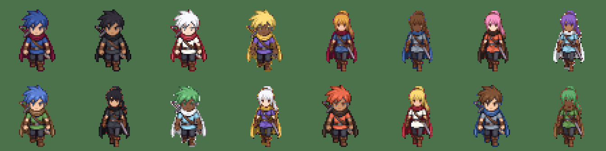

# Creador de personaje

Es la primera pantalla del juego (`scenes/ui/character_creator.tscn`). Se elige:

| Opción | Qué cambia |
|---|---|
| Género | El modelo dibujado: hombre o mujer |
| Peinado | Los peinados dibujados para ese género (de momento uno por género: puntas y coleta) |
| Pelo | 10 colores (el original, negro, castaño, rubio, pelirrojo, blanco, azul, rosa, verde y morado) |
| Piel | 5 tonos (el original, clara, media, morena y oscura) |
| Atuendo | 8 combinaciones de colores para la túnica y la capa con la bufanda |

Flechas o WASD para elegir, Intro para confirmar. También se puede usar el ratón. «Aleatorio» sortea
un aspecto. Al empezar se guarda en `user://personaje.json` y el juego lo usa en todos los niveles.

## Cómo funciona

- **Modelos.** Cada modelo es un juego completo de sprites del héroe: `assets/characters/hero/<set>.png`
  con `<set>_frames.tres`, con las mismas animaciones. Están en la lista `MODELS` de
  `scripts/systems/hero_look.gd`.
- **Colores.** `tools/art_pipeline/build.py` guarda junto a cada juego una máscara (`<set>_mask.png`)
  que dice qué píxeles son pelo, piel, ropa o capa (tabla `LOOK_GROUPS`). Al cargar, `HeroLook` pinta
  cada grupo con el color elegido y conserva el sombreado del dibujo.

## Añadir un peinado o un atuendo dibujado

1. Generar las tres hojas (caminar, ataques, esquivas) con la misma rejilla que las de la heroína
   (`art/FUENTES.md`) y dejarlas en `art/ai/heroes/`.
2. Añadir su receta en `build.py` (como `heroine()`) y sus grupos de color en `LOOK_GROUPS`.
3. Añadir una línea a `MODELS` en `hero_look.gd`. El creador lo muestra solo.

## Pendiente

Las hojas de ataque y esquiva de la heroína salen de las miniaturas de 256 px de Figma, porque se
alcanzó el límite diario de llamadas de Figma antes de descargarlas a tamaño completo. Funcionan, pero
están algo más borrosas y son algo más grandes que las de caminar. Cuando estén las hojas grandes
(nodos 2:2 y 3:2 del archivo «Brumaclara — Arte del juego (vistas y personaje)»), se sustituyen
`art/ai/heroes/mujer_actions.png` y `mujer_extra.png` y se ejecuta `build.py heroine`.
